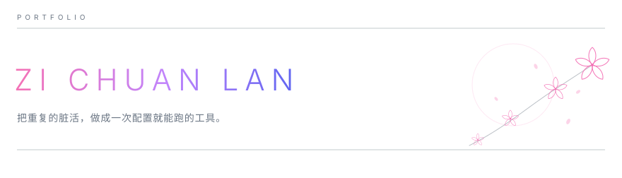

## Agent 工具链

[agent-purge](https://github.com/ZiChuanLan/agent-purge) · [some-magic](https://github.com/ZiChuanLan/some-magic) · [pi-purge](https://github.com/ZiChuanLan/pi-purge) · [pi-subagents-lite](https://github.com/ZiChuanLan/pi-subagents-lite) · [pi-image-placeholder](https://github.com/ZiChuanLan/pi-image-placeholder)

## 信息聚合

[freebie-radar](https://github.com/ZiChuanLan/freebie-radar) · [meta-gateway](https://github.com/ZiChuanLan/meta-gateway) · [inception-web-api](https://github.com/ZiChuanLan/inception-web-api) · [newapi-sync-tool](https://github.com/ZiChuanLan/newapi-sync-tool)

## 内容工具

[PDF2PPT](https://github.com/ZiChuanLan/PDF2PPT) · [ppt-mcp](https://github.com/ZiChuanLan/ppt-mcp) · [ppt-master](https://github.com/ZiChuanLan/ppt-master)（fork） · [tikuAdapter](https://github.com/ZiChuanLan/tikuAdapter)（fork）

全部仓库在 <a href="https://github.com/ZiChuanLan?tab=repositories">这里</a>

